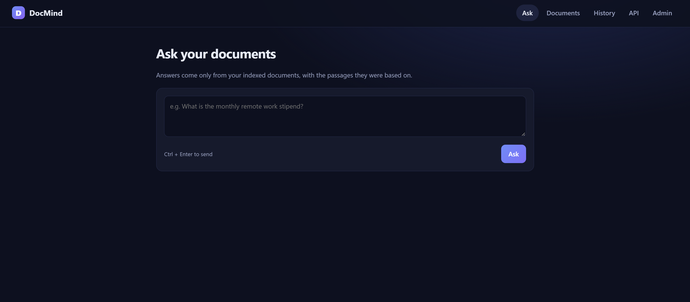
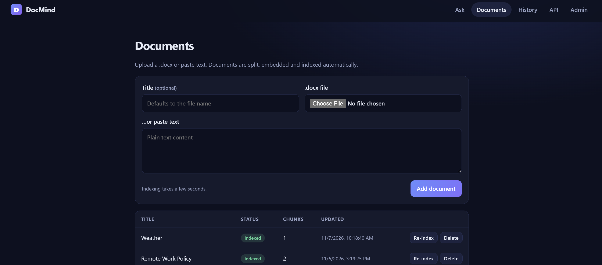
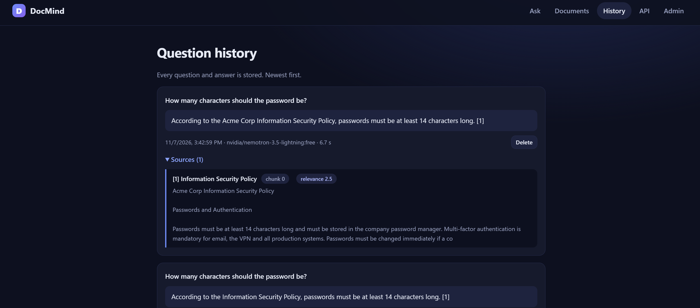
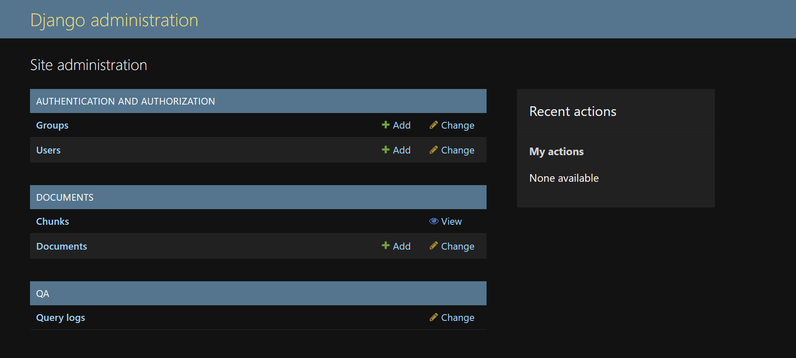
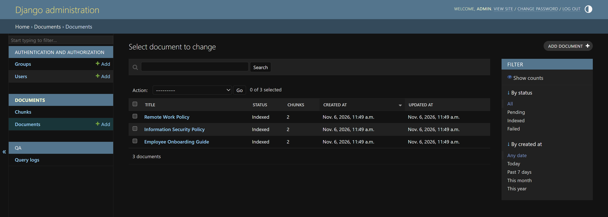
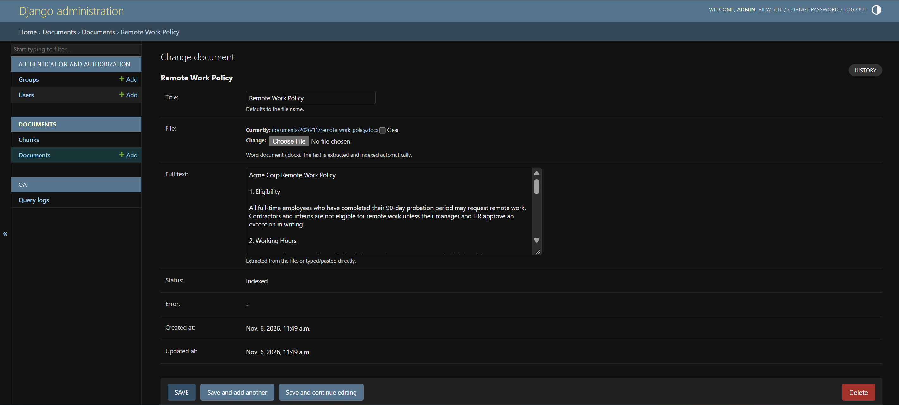
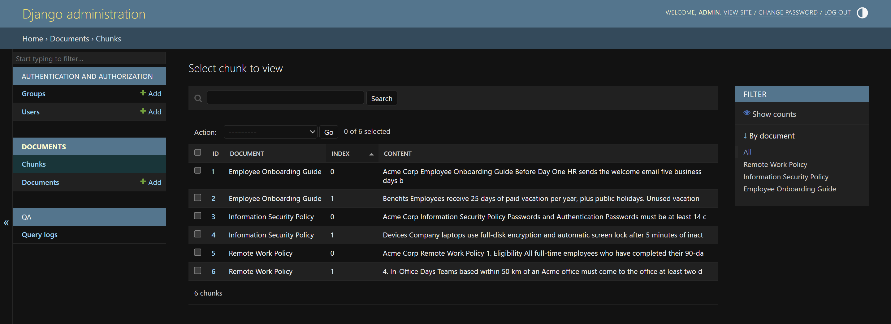
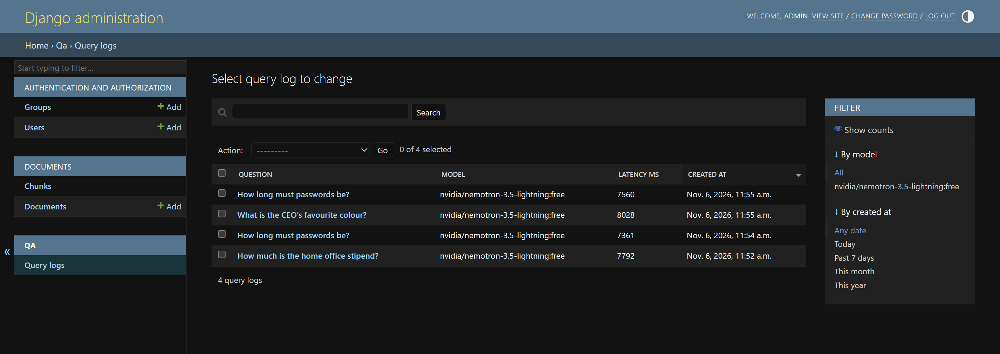
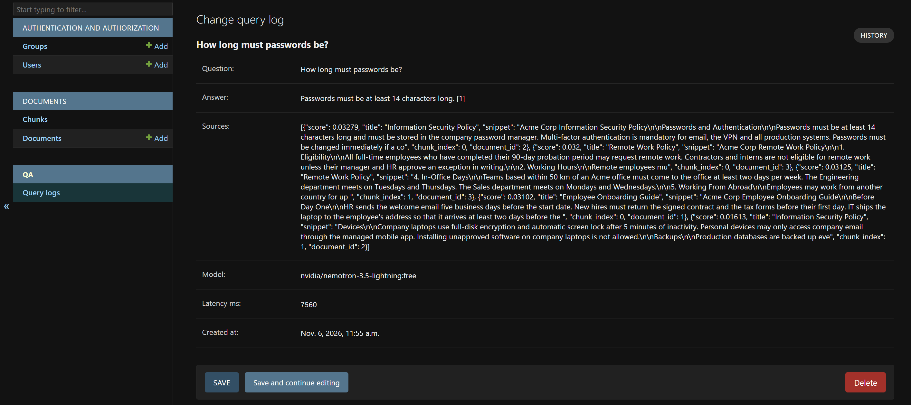
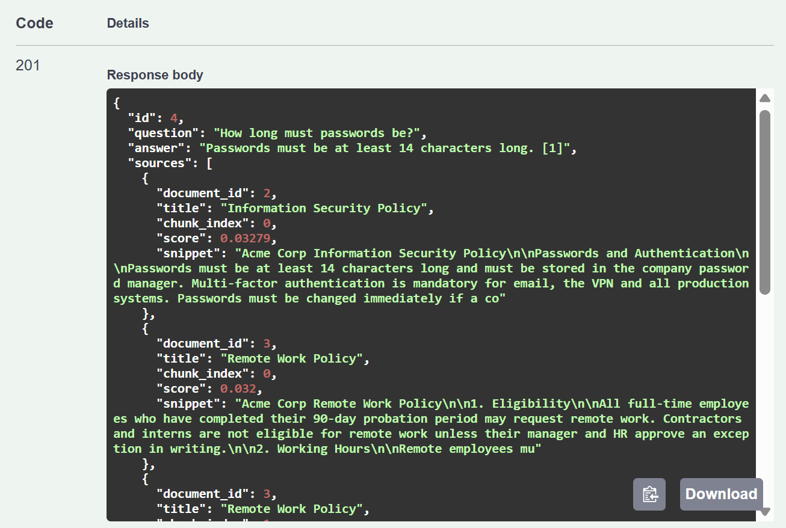

# DocMind RAG

Document question answering with **Django + LangChain + PostgreSQL/pgvector**. Upload `.docx` files (or paste text),
search them, and ask questions; answers are generated by an OpenRouter LLM from the retrieved passages, with sources.
The UI is the Django Admin plus a small web interface; everything is also available through a REST API with Swagger docs.

Repository: <https://github.com/niusha-yaghini/docmind-rag>

## Quick start (Docker)

1. Create an OpenRouter API key at <https://openrouter.ai> and pick a chat model from the
   [free models list](https://openrouter.ai/collections/free-models).
2. Create the env file and fill in `OPENROUTER_API_KEY` and `LLM_MODEL` (the model id, e.g. `vendor/model:free`):

   ```bash
   cp .env.example .env        # Windows CMD: copy .env.example .env
   ```

3. Start everything:

   ```bash
   docker compose up --build
   ```

4. Open:
   - Web UI: <http://localhost:8000/>
   - Admin: <http://localhost:8000/admin/> (default login `admin` / `admin12345`, change it in `.env`)
   - API docs (Swagger): <http://localhost:8000/api/docs/>
5. Load the sample documents and try a question:

   ```bash
   docker compose exec web python manage.py load_sample_data
   curl -X POST http://localhost:8000/api/ask/ -H "Content-Type: application/json" \
        -d '{"question": "How much is the home office stipend?"}'
   ```

   More sample questions with expected answers: [`sample_data/sample_questions.md`](sample_data/sample_questions.md).

Migrations, static files and the admin user are handled automatically by `docker/entrypoint.sh`.

The first build downloads the Python packages and the reranker model (about 80 MB) and can take several minutes.
Later starts reuse the image: `docker compose up -d` (add `--build` only after changing code or `requirements.txt`).

### Build notes: PyPI mirror

The `Dockerfile` installs Python dependencies from the Tsinghua PyPI mirror
(`https://pypi.tuna.tsinghua.edu.cn/simple`) instead of the default PyPI index. The packages and the pinned versions in
`requirements.txt` are identical; only the download host differs. It was chosen because `files.pythonhosted.org` was not
reachable from the development network. If your network reaches the official PyPI and you prefer it, change this line in
the `Dockerfile`:

```
--index-url https://pypi.tuna.tsinghua.edu.cn/simple   ->   --index-url https://pypi.org/simple
```

and rebuild with `docker compose build --no-cache`.

The cross-encoder reranker model (`Xenova/ms-marco-MiniLM-L-6-v2`) is downloaded from Hugging Face during the image
build. If that download fails (offline build), the build still succeeds and the app falls back to the plain
hybrid-retrieval order (reranking is skipped, with a warning in the logs).

## How it works

```
 .docx / text ──► extract full text ──► split into chunks ──► embed (OpenRouter) ──► PostgreSQL
                  (python-docx,          (LangChain             (OpenAIEmbeddings)    ├─ Chunk.embedding  (pgvector, HNSW)
                   tables included)       RecursiveCharacter…)                        └─ Chunk.search_vector (tsvector, GIN)

 question ──► HybridRetriever ──► top-k chunks ──► prompt ──► LLM (OpenRouter) ──► answer + sources ──► QueryLog
              ├─ vector search (cosine)   fused with
              └─ full-text search         Reciprocal Rank Fusion
```

- **Full text** of each document is stored on `Document.full_text`; chunks live in `Chunk`.
- **Hybrid retrieval** (`qa/retriever.py`): semantic search finds paraphrases, full-text search finds exact terms
  (numbers, names, "14 characters"). Each returns 20 candidates; Reciprocal Rank Fusion merges them.
- **Reranking** (`qa/reranker.py`): the fused top 20 are re-scored by a local cross-encoder
  (`Xenova/ms-marco-MiniLM-L-6-v2`, run with fastembed/ONNX, no API call). It reads the question and each passage
  together and outputs a relevance score (higher = more relevant, above 0 is usually a real match); the best 5 go to
  the LLM. Stored embeddings are not changed, only the order. If the model is unavailable the retriever falls back to the
  fused order with a logged warning. Each source shows its score as a "relevance" badge in the UI and as `rerank_score`
  in `/api/search/` and in the saved sources. The model is English-only; for other languages set `RERANK_MODEL` to a
  multilingual reranker supported by fastembed.
- **Chain** (`qa/chain.py`): one LangChain LCEL chain: retriever → prompt → LLM → parser. The prompt answers only from the
  numbered passages and cites them. It has three outcomes: a full answer; a **partial answer** ("I don't have direct
  information about this in the documents, but ..." plus what the documents do say); or the exact not-found sentence.
  Passages are treated as untrusted text. The stored/returned sources are only the passages the answer cites
  (none for a not-found answer).
- **History**: every answer is saved in `QueryLog` with its sources, model and latency.

## API

Interactive docs: `/api/docs/` (OpenAPI schema: `/api/schema/`). The API is open in this version (no auth).

| Method | Path | Purpose |
|---|---|---|
| `GET` | `/api/documents/` | List documents (`?search=title`, `?ordering=-created_at`, paginated) |
| `POST` | `/api/documents/` | Create: multipart `file` (.docx) and/or `full_text`; optional `title` (defaults to file name) |
| `GET` | `/api/documents/{id}/` | Detail, including `full_text`, `status`, `error`, `chunk_count` |
| `PUT` `PATCH` | `/api/documents/{id}/` | Update. Changing `file` or `full_text` re-indexes; changing only `title` does not |
| `DELETE` | `/api/documents/{id}/` | Delete document, its chunks and its file |
| `POST` | `/api/documents/{id}/reindex/` | Rebuild chunks/embeddings (e.g. after a failed indexing) |
| `GET` | `/api/search/?q=...&k=5` | Most relevant chunks, no LLM call |
| `POST` | `/api/ask/` | `{"question": "..."}` → answer, sources, model, latency; saved to history |
| `POST` | `/api/ask/stream/` | Same as `/api/ask/`, but streams the answer as Server-Sent Events (`token`, then `done` or `error`). |
| `GET` | `/api/history/` | Past questions and answers (newest first) |
| `GET` `DELETE` | `/api/history/{id}/` | One history entry |

Examples:

```bash
curl -F "file=@sample_data/remote_work_policy.docx" http://localhost:8000/api/documents/
curl -X POST http://localhost:8000/api/documents/ -H "Content-Type: application/json" \
     -d '{"title": "Notes", "full_text": "Our office is closed on Fridays."}'
curl "http://localhost:8000/api/search/?q=internet+allowance"
```

Errors: `400` validation (bad file, empty body), `503` missing configuration (API key / model), `502` upstream
LLM or embedding failure. Indexing problems never lose the document: it is saved with `status=failed` and a readable `error`.

## Web UI

A small dependency-free web interface (Django templates + vanilla JS calling the REST API) is served at `http://localhost:8000/`:

- **Ask**: question box with the answer and the passages it was based on.
- **Documents**: upload a `.docx` or paste text, see index status and chunk counts, re-index or delete.
- **History**: all stored questions and answers.

Django Admin (`/admin/`) and Swagger (`/api/docs/`) remain available. The UI lives in the `web/` app and adds no API endpoints.

## Admin

`/admin/` provides:

- **Documents**: add/edit/delete, upload a `.docx` (text is extracted and indexed on save), edit `full_text` by hand,
  see status and chunk count, and a **Re-index selected documents** action.
- **Chunks**: read-only view of exactly what the retriever sees.
- **Query logs**: read-only history with sources, model and latency.

## Screenshots

All screenshots are in [`docs/screenshots/`](docs/screenshots/).

**Web UI** (`/`)

| | |
|---|---|
|  |  |
| *Ask: answer with the passages it was based on and their relevance score* | *Documents: upload, status, chunk counts* |


*History: every stored question and answer, with sources*

**Django Admin** (`/admin/`)


*Admin home*


*Documents list with status and chunk count*


*Document form: file, extracted full text, status and error*


*Chunks: read-only view of exactly what the retriever searches*


*Query logs: question, model and latency*


*One query log with answer and sources*

**API documentation** (Swagger UI at `/api/docs/`)


*`POST /api/ask/` response*

> The Admin query-log detail and the Swagger response were captured with an earlier build. Today the stored sources
> contain only the passages the answer cites, each with a `ref` number and, when reranking ran, a `rerank_score`
> (see the Ask and History screenshots).

## Configuration

All settings are environment variables, documented in [`.env.example`](.env.example). The important ones:

| Variable | Meaning |
|---|---|
| `OPENROUTER_API_KEY`, `LLM_MODEL` | Required for `/api/ask/`. `LLM_FALLBACK_MODELS` (comma-separated) is tried if the main model fails |
| `EMBEDDING_MODEL`, `EMBEDDING_DIM` | Default `liquid/lfm-2.5-embedding-350m:free`, 1024 dims. See the note below before changing |
| `CHUNK_SIZE`, `CHUNK_OVERLAP` | Chunking (characters), default 1000 / 150 |
| `RETRIEVAL_CANDIDATES`, `RETRIEVAL_TOP_K` | Per-retriever candidates (20) and chunks sent to the LLM (5) |
| `RERANK_ENABLED`, `RERANK_MODEL`, `RERANK_POOL` | Cross-encoder reranking on/off (default on), its model, and how many fused candidates it re-scores (20) |

Changing the embedding model to one with a different dimension requires editing `EMBEDDING_DIMENSIONS` in
`documents/models.py`, creating a migration, and re-indexing all documents.

## Retrieval evaluation

`python manage.py evaluate` measures retrieval quality without calling the LLM. It indexes a small evaluation corpus
(`eval/corpus.json`: 10 policy documents full of look-alike facts), asks the 26 questions in `eval/questions.json`
and checks where the chunk containing the expected phrase appears. It prints hit rate@1/3/5 and MRR for four
strategies: vector only, keyword only, hybrid (RRF) and hybrid + rerank. The temporary documents are deleted afterwards.

```bash
docker compose exec web python manage.py evaluate            # summary table
docker compose exec web python manage.py evaluate --verbose  # rank of the right chunk for every question
```

- **Hit rate@k**: share of questions whose right chunk is among the first k results.
- **MRR**: mean of 1/rank of the right chunk (1 if first, 0.5 if second, 0 if missing).
- It needs the embedding API but not the chat model, and sends a single embedding request for all chunks and questions
  (free OpenRouter models allow only a limited number of requests per day).
- The corpus is small, so the reranker sees almost every chunk; on a large index the first stage matters more.
- `eval/make_eval_data.py` regenerates the two JSON files.

## Tests

The suite runs against a real PostgreSQL with pgvector; the LLM and embeddings are replaced by deterministic fakes, so no API key or network is needed.

```bash
docker compose run --rm web sh -c "pip install -r requirements-dev.txt && pytest"
```

Locally (needs Postgres with the pgvector extension): `pip install -r requirements-dev.txt && pytest`.

## Design decisions

- **pgvector inside PostgreSQL** instead of a separate vector DB: one service, transactional deletes/updates with the
  documents, and full-text search in the same database for the hybrid retriever.
- **Own `Chunk` model + a small custom LangChain retriever** instead of the generic vector-store wrapper: keeps the ORM,
  Admin and cascades working, and makes the retrieval logic short enough to read in one file.
- **Hybrid retrieval with RRF**: embeddings alone miss exact tokens; keywords alone miss paraphrases. RRF needs no score
  normalisation or tuning.
- **Synchronous indexing**: simplest thing that works for the expected document sizes. A failure is recorded on the document instead of raised.
- **The chain runs sequentially, not with `RunnableParallel`**: its thread pool would use extra Django DB connections that are never closed.
- **OpenRouter for both chat and embeddings** via the OpenAI-compatible client, so switching models is a config change.

## Limitations and next steps

- Only `.docx`; images inside documents are ignored (tables are included).
- Full-text search uses the `english` configuration; other languages rely on the embeddings.
- Free OpenRouter models are rate limited and can be unavailable; use `LLM_FALLBACK_MODELS`. Free embedding endpoints may
  retain data, so do not upload confidential documents.
- Indexing blocks the request; large files would need a task queue (Celery/RQ).
- The API has no authentication. Next: token auth, per-user documents, conversation memory, PDF support.

## Project layout

```
config/            Django settings, urls, wsgi
documents/         Document + Chunk models, admin, REST API
  services/        extract.py (docx -> text), embeddings.py (OpenRouter), ingest.py (split, embed, index)
  management/      load_sample_data command
qa/                question answering
  retriever.py     hybrid retriever: pgvector + full-text search, RRF fusion, optional rerank stage
  reranker.py      local cross-encoder (fastembed/ONNX) that re-scores the fused candidates
  chain.py         LangChain LCEL chain and the prompt (full / partial / not-found answers)
  llm.py           chat model factory with fallbacks
  services.py      answer_question / stream_answer, source selection, QueryLog persistence
  views.py         ask, ask/stream (SSE), search, history endpoints
  evaluation.py    hit rate and MRR helpers
  management/      evaluate command (retrieval quality report)
web/               Django-template UI (Ask, Documents, History) with vanilla JS and CSS
eval/              evaluation corpus (10 documents), 26 questions, generator script
sample_data/       3 sample .docx files, sample questions, generator script
tests/             pytest suite (real PostgreSQL + pgvector, fake embeddings and LLM)
docs/            technical report (PDF and DOCX) and screenshots/ (UI, Admin, Swagger)
docker/            entrypoint.sh (migrate, collectstatic, create admin, gunicorn)
Dockerfile, docker-compose.yml, requirements.txt, requirements-dev.txt, .env.example, pytest.ini
```
